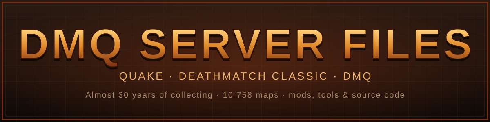
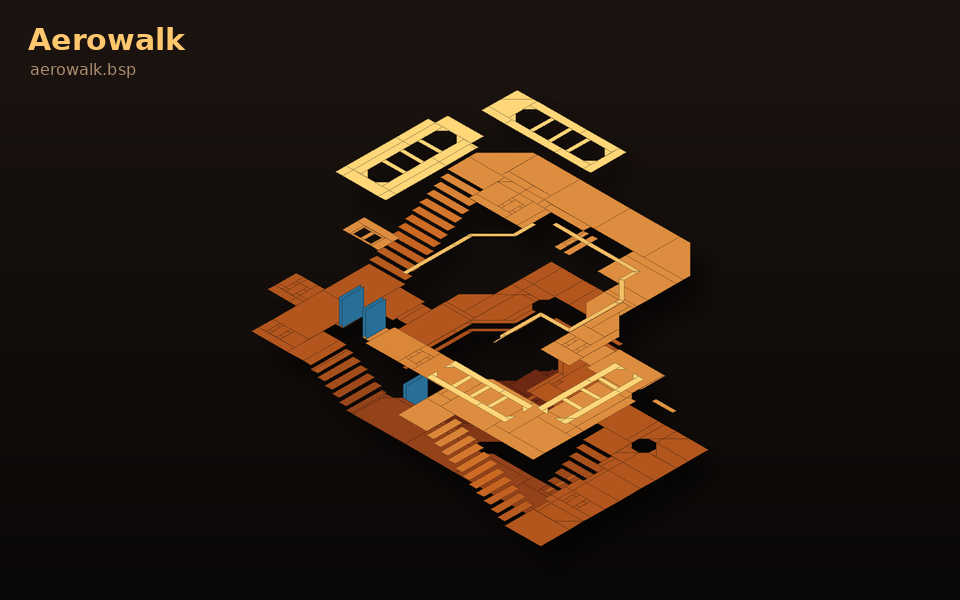
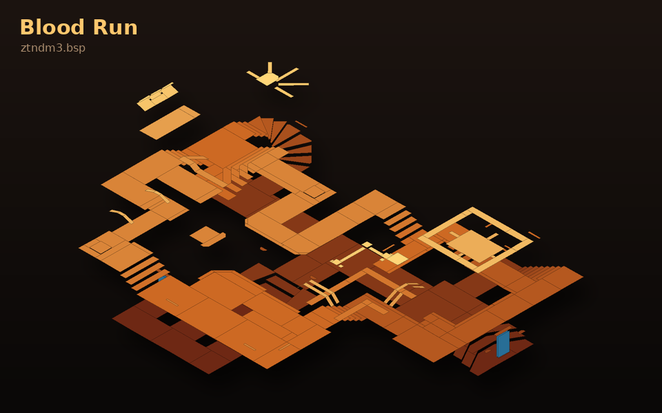
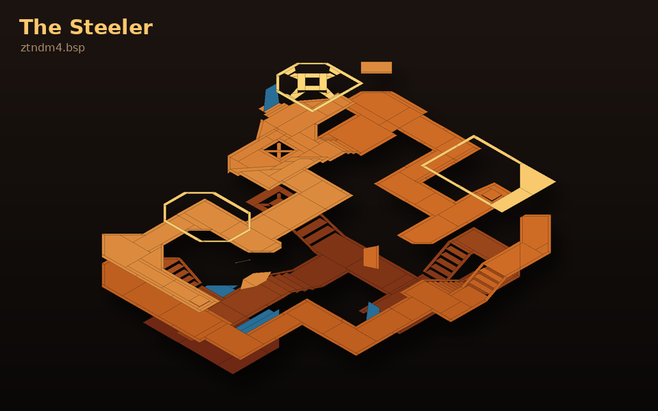
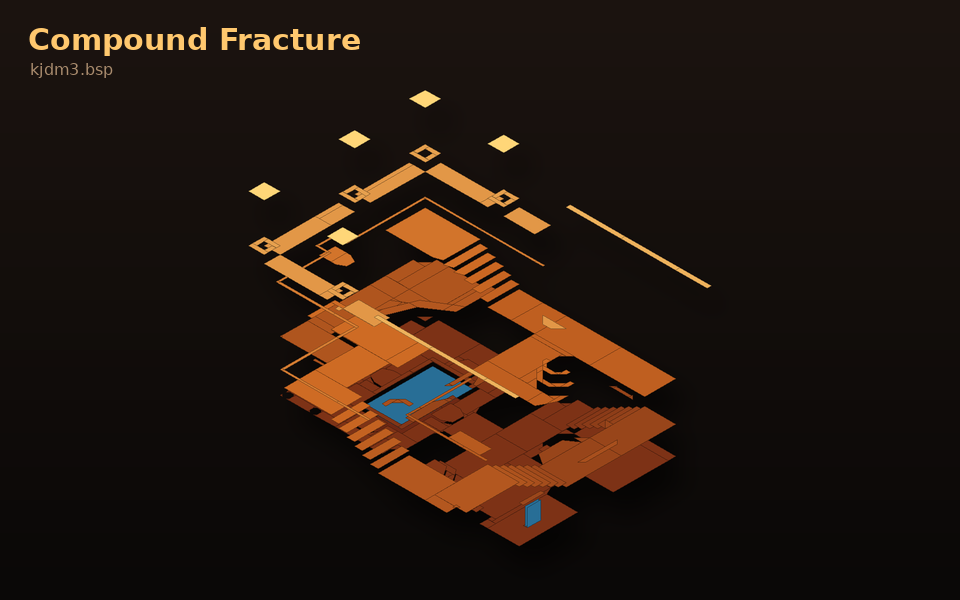
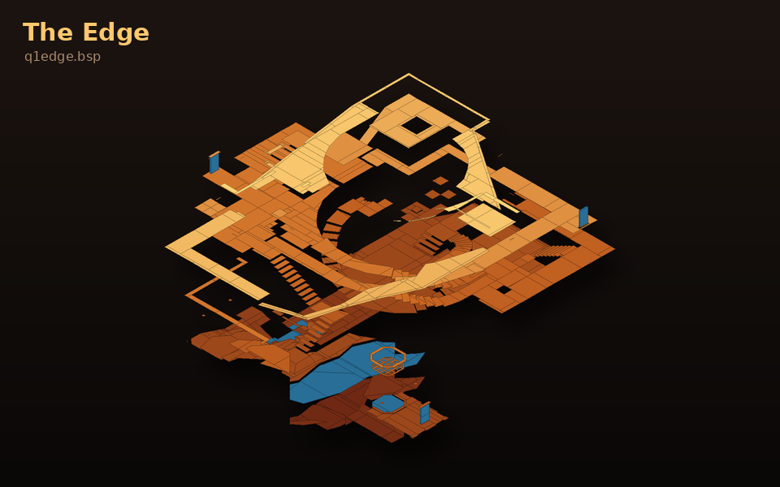
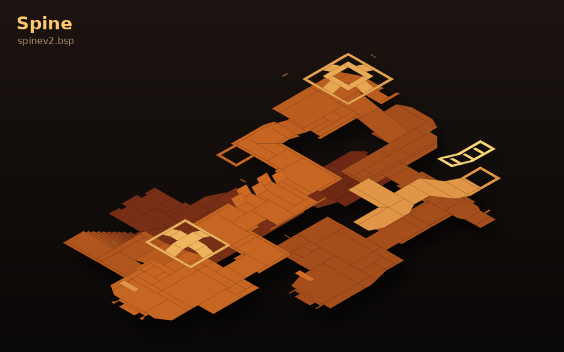

  

  
  
  

**Almost 30 years of collecting.** 🕹️ Since the late 1990s, Billy has gathered
and kept server files, maps, mods, tools and source code from the **Quake 1**,
**Deathmatch Classic (DMC)** and **DMQ** community scene: from old community
servers, from the people he played with, and from his own backups. Much of it
is no longer available anywhere else online. This archive preserves that
collection in one place.

| | |
|---|---|
| 📦 **Download everything** | [Hugging Face dataset](https://huggingface.co/datasets/Nomatter/dmq-server-files): every file, 9.3 GiB |
| 📖 **What is in it** | [INDEX.md](INDEX.md): a guide to every item, what it is and who made it |
| 🔎 **Find a map** | [catalog/maps.csv](catalog/maps.csv): all 10 963 maps with in-game titles |
| 🗜️ **Look inside archives** | [catalog/archive-contents.csv](catalog/archive-contents.csv): every file in every zip/rar/7z |
| 📊 **Folder overview** | [CATALOG.md](CATALOG.md): file counts and sizes per folder |

> ℹ️ **This GitHub repository is the index:** catalog, scripts, images and the two
> source trees you can browse online (`dmq/source/dmq2-source-2/`,
> `dmc/source/DMC_Pro_2.0_Source/`). **All files** live in the
> [Hugging Face dataset](https://huggingface.co/datasets/Nomatter/dmq-server-files) under the same paths.

---

## 🕯️ In memory of PIX

**DMQ 2 exists because of PIX.** He wrote most of its code on his own, building
on DMC Pro by TrenD*KilleR, and the DMQ servers this archive comes from ran on
his work. Every map rotation, every vote and every duel in `dmq/` traces back
to what he built.

To the people who played DMQ he was more than a name in a readme. He was a
friend from another country: someone you knew through the game, never met in
person, and faced in more matches than anyone could count.

This archive is kept in his honour. His source code is preserved unchanged in
[`dmq/source/dmq2-source-2/`](dmq/source/dmq2-source-2/), with these words
added at the top of its readme:

> Memorial for PIX, the legend that was a god in coding, that did most of the
> coding for DMQ2 alone. Everytime Quake is on my mind I think about you old friend!
> Rest in peace PIX!
> &nbsp;-Billy

---

## 🗺️ From the collection

Six classic deathmatch maps from the archive, drawn straight from their `.bsp`
files: floors coloured by height, teleporters and liquids in blue.

| | |
|:---:|:---:|
|  |  |
| **Aerowalk** · Mattias Konradsson, the QuakeWorld duel classic | **Blood Run** (ztndm3) · Sten "ztn" Uusvali |
|  |  |
| **The Steeler** (ztndm4) · Sten "ztn" Uusvali | **Compound Fracture** (kjdm3) · Killjoy |
|  |  |
| **The Edge** (q1edge) · the Quake 2 classic converted to Quake | **Spine v2** · headshot, QonFerence '98 tournament map |

Rendered with <code>tools/render_map.py</code>. Point it at any Quake 1 map in the archive.

---

## 📦 What's inside

- 🎮 **DMQ:** DMQ 2 source code by PIX, server builds, mapcycles, vote plugins, map textures and the old **dmq.geeky.cc** site
- 🔫 **DMC:** DMC Pro 2.0 source code, DMC Pro 1.0, standard maps, Half-Life SDK
- 🗺️ **Quake maps:** 6 526 loose maps, 3 331 original single-map releases with readmes, and packs like Rocket Arena maps, UKPAK and the ztn and Killjoy series
- 🚀 **Mods:** Rocket Arena 1.2, Clan Arena X, Threewave CTF, Team Fortress, grappling hooks, camera mods, mods for the 2021 remaster
- 💾 **Source code:** id Software's Quake source, Quake 1.06 QuakeC, CRMod, Rocket Arena and Clan Arena QuakeC
- 🖥️ **Servers:** QWAdmin, KTX, Quake TV, Qsmack, Qvote, admin mods
- 🛠️ **Tools:** TrenchBroom, QuArK, Qoole, BSP Editor, ericw-tools, tyrutils, FTEQCC, pak explorers, Quake Injector
- 🔊 **Sounds:** Quake 3 and Unreal Tournament announcers, kill-streak packs, Clan Arena sounds
- 👾 **Other games:** Quake 2 and Quake 3 maps, Doom

👉 Every item is described in **[INDEX.md](INDEX.md)**.

<b>📂 Folder layout</b> (click to open)

| Folder | What is there |
|---|---|
| `dmq/source/` | DMQ 2 source code by PIX (based on DMC Pro by TrenD*KilleR) |
| `dmq/releases/` | DMQ2 beta 3, three mfrx server builds and the required server packs (mapcycles, vote config) |
| `dmq/map-textures/` | High- and low-res texture WADs for the DMQ maps |
| `dmq/server-plugins/` | mfrx plugins (vote, details) for DMQ servers |
| `dmq/website/` | Saved pages from the old dmq.geeky.cc site |
| `dmc/source/` | DMC Pro 2.0 source code |
| `dmc/releases/` | DMC Pro 1.0 and a DMC client.dll |
| `dmc/maps/` | Standard DMC maps, the dmc.wad textures and 11 loose Half-Life-engine maps |
| `dmc/hlsdk/` | Half-Life SDK |
| `dmc/amxmodx-plugins/` | AMX Mod X plugins |
| `quake/maps/bsp/` | 6 526 loose Quake 1 maps (.bsp) |
| `quake/maps/single-map-zips/` | 3 331 single-map zips with their readme .txt files |
| `quake/maps/packs/` | Map packs (incl. the 1 GB deathmatch-maps.zip, Rocket Arena maps) |
| `quake/mods/` | Rocket Arena 1.2 (client + server), Clan Arena X, 3Wave CTF, Team Fortress, hook mods, QE mods … |
| `quake/qc-source/` | QuakeC and engine source: id's q1source, progs 1.06, CRMod, clean QC … |
| `quake/engines/` | FTE, QuakeSpasm, QuakeWorld 2.30, ezQuake builds, Quake 1.08, QuakePatches |
| `quake/server/` | QWAdmin, KTX, QTV, qsmack, qvote, admin mods, mission-pack qwprogs |
| `quake/tools/` | Editors (TrenchBroom, BSP, QuArK, Qoole), compilers (ericw-tools, tyrutils, fteqcc), pak tools, launchers |
| `quake/sounds/` | Announcer packs (Quake 3, Unreal Tournament) and game sounds |
| `quake/textures/` | Texture WADs |
| `other-games/` | Quake 2 maps (65), Quake 3 maps and Doom files that ended up in the collection |
| `misc/` | Unrelated installers kept as they were found (VSCode, .NET, JRE …) |
| `tools/` | Scripts that built this layout, the catalog and the map renders |
| `assets/` | Banner and map images for this page |

<b>🛠️ How this archive was put together</b>

The files were imported in their original layout first, then sorted in rename
commits. `tools/MOVES.tsv` and `tools/MOVES-2.tsv` list every move from the old
path to the new one, so anything can be traced back to where it was found.
13 byte-identical duplicates were dropped during sorting, and every file on
Hugging Face was checked against the local archive by hash.

Regenerate the catalog with `python3 tools/catalog.py .` from the archive root.

---

## ⚖️ Rights

This is a preservation archive. The maps, mods and tools belong to their
original authors; their readme files are kept next to them. Contact the
maintainer if you are an author and want something credited differently or removed.
