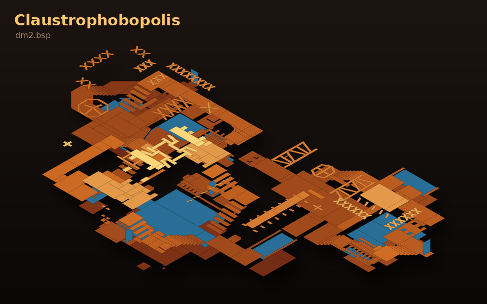
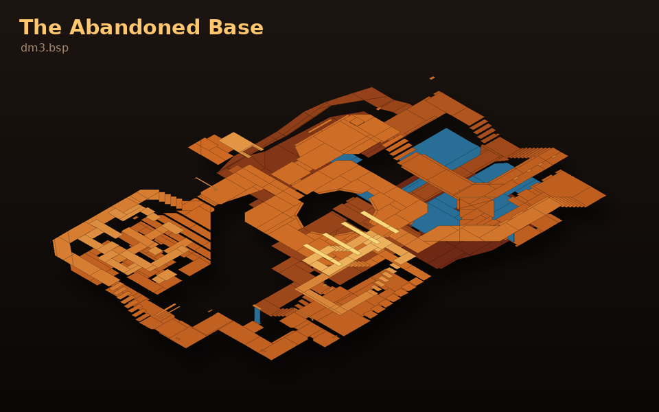
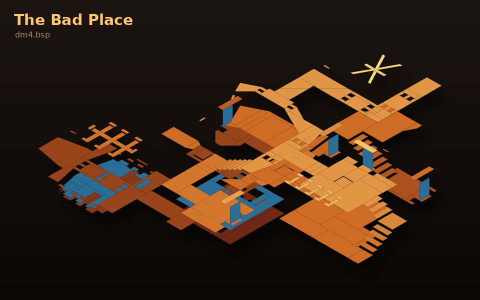
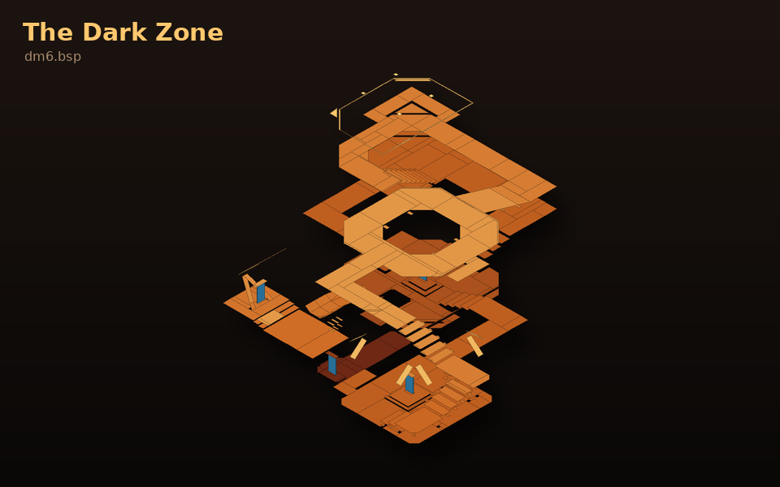
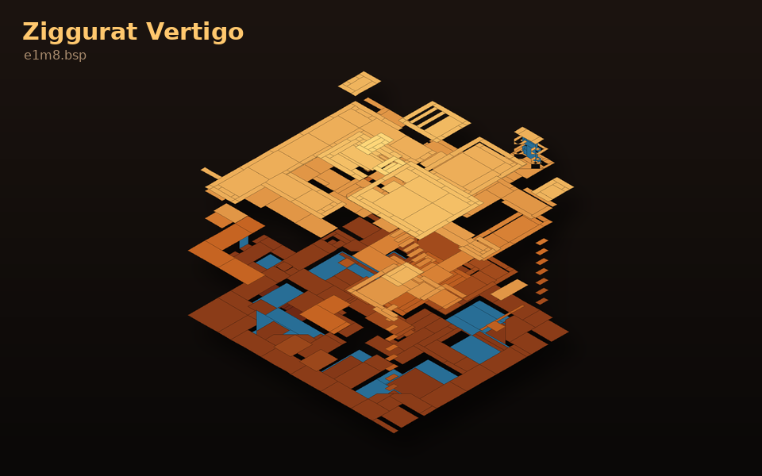
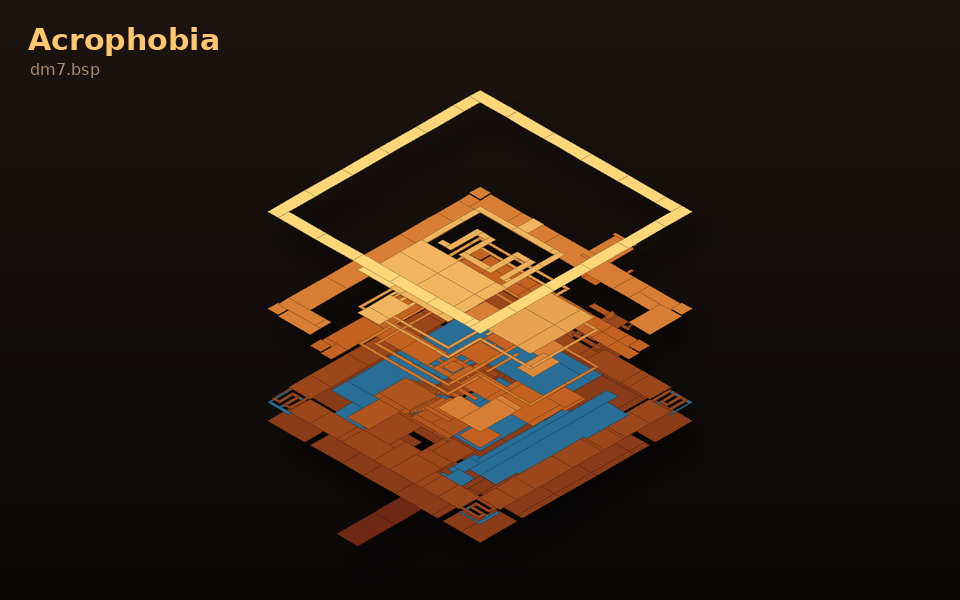

  

  
  
  

**Almost 30 years of collecting.** 🕹️ Since the late 1990s, Billy has gathered
and kept server files, maps, mods, tools and source code from the **Quake 1**,
**Deathmatch Classic (DMC)** and **DMQ** community scene: from old community
servers, from the people he played with, and from his own backups. Much of it
is no longer available anywhere else online. This archive preserves that
collection in one place.

| | |
|---|---|
| 📦 **Download everything** | [Hugging Face dataset](https://huggingface.co/datasets/Nomatter/dmq-server-files): every file, 8.6 GiB |
| 📖 **What is in it** | [What's inside](#-whats-inside), further down this page: every item, what it is and who made it |
| 🔎 **Find a map** | [Maps by letter](catalog/README.md#maps-by-first-letter): all 10 758 maps with in-game titles and authors |
| 🗜️ **Look inside archives** | [Archive contents per folder](catalog/README.md#inside-the-archives-per-folder): every file in every zip/rar/7z |
| 📊 **Folder overview** | [CATALOG.md](CATALOG.md): file counts and sizes per folder |

> ℹ️ **This GitHub repository is the index:** catalog, scripts, images and the two
> source trees you can browse online (`dmq/source/dmq2-source-2/`,
> `dmc/source/DMC_Pro_2.0_Source/`). **All files** live in the
> [Hugging Face dataset](https://huggingface.co/datasets/Nomatter/dmq-server-files) under the same paths.

---

## 🕯️ In memory of PIX

**DMQ 2 exists because of PIX.** He wrote most of its code on his own, building
on DMC Pro by TrenD*KilleR, and the DMQ servers this archive comes from ran on
his work. Every map rotation, every vote and every duel in `dmq/` traces back
to what he built.

To the people who played DMQ he was more than a name in a readme. He was a
friend from another country: someone you knew through the game, never met in
person, and faced in more matches than anyone could count.

This archive is kept in his honour. His source code is preserved unchanged in
[`dmq/source/dmq2-source-2/`](dmq/source/dmq2-source-2/), with these words
added at the top of its readme:

> Memorial for PIX, the legend that was a god in coding, that did most of the
> coding for DMQ2 alone. Everytime Quake is on my mind I think about you old friend!
> Rest in peace PIX!
> &nbsp;-Billy

---

## 🗺️ From the collection

The classics, drawn straight from their `.bsp` files in the archive: the
real map geometry seen from above at an angle. Only the floors are drawn
(walls and ceilings would hide them), coloured by height from dark red (low)
to yellow (high); teleporters and liquids are blue.

| | |
|:---:|:---:|
|  |  |
| **DM2** · Claustrophobopolis | **DM3** · The Abandoned Base |
|  |  |
| **DM4** · The Bad Place | **DM6** · The Dark Zone |
|  |  |
| **E1M8** · Ziggurat Vertigo | **DM7** · Acrophobia (Piramida) |

Rendered with <code>tools/render_map.py</code>. Point it at any Quake 1 map in the archive.

---

## 📦 What's inside

**At a glance:** 10 758 maps (6 731 unique), the DMQ 2 and DMC Pro source
code, Rocket Arena and Clan Arena (server and QuakeC source), Threewave CTF,
Team Fortress, id Software's Quake source, classic map editors and compilers,
QuakeWorld server tools, and the old dmq.geeky.cc website. Descriptions below
come from the readme files that shipped with each item.

### 🎮 DMQ — Deathmatch Quake for Half-Life

DMQ brought Quake-style deathmatch to the Half-Life engine. DMQ 2 was written
mostly by **PIX**, based on DMC Pro by TrenD*KilleR.

| Path | What it is |
|---|---|
| `dmq/source/dmq2-source-2/` | **DMQ 2 source code by PIX** (client `cl_dll`, server `dlls`, shared `pm_shared`), with Billy's memorial at the top of `readme.txt` |
| `dmq/source/dmq2-source-2.zip`, `.rar`, `-copy.rar` | The same source as originally archived |
| `dmq/releases/DMQ2-beta3.zip` | DMQ 2 beta 3 server game DLL (`dmc.dll`) |
| `dmq/releases/dmq2-mfrx-1.zip` … `-3.zip` | Three DMQ 2 game DLL builds (`dmc.dll`) from the mfrx servers |
| `dmq/releases/DMQ2-Required.zip` | Required server pack: game-mode configs by TrenD*KilleR |
| `dmq/releases/DMQ-Required.something.zip` | Server mapcycles (1on1, 2on2, 3on3, 4on4, arena) and vote settings |
| `dmq/map-textures/HighResDmqMaps.zip`, `LowResDmqMaps.zip` | Texture WADs and detail-texture files for the DMQ maps (dm4–dm6, dmb, dmz, ztndm3 …) |
| `dmq/server-plugins/plugin_mfrx_vote*.zip` | mfrx vote plugin (AMX) and its source (`.sma`): vote for team/arena/1on1/2on2 |
| `dmq/server-plugins/plugin_mfrx_details.zip` | mfrx details plugin (AMX) |
| `dmq/website/dmq.geeky.cc/` | Saved pages of the DMQ community site: servers, players, textures, requests |

### 🔫 DMC — Deathmatch Classic (Half-Life)

| Path | What it is |
|---|---|
| `dmc/source/DMC_Pro_2.0_Source/` | **DMC Pro 2.0 source code** by TrenD*KilleR, the base DMQ 2 was built on |
| `dmc/source/DMC_Pro_2.0_Source.rar` | The same source as originally archived |
| `dmc/releases/dmc_pro_v1.0.zip` | DMC Pro 1.0, released 11 January 2004 |
| `dmc/releases/client.zip` | A DMC client DLL |
| `dmc/maps/standard-maps.zip` | The standard DMC maps (dcdm5, dmc_dm2–dm6, dmc_e1m2 …) |
| `dmc/maps/textures.zip` | `dmc.wad` plus detail-texture files for the DMC maps |
| `dmc/maps/bsp/` | 11 loose Half-Life-engine maps found among the Quake maps (TFC rocket-jump maps, sniper duel, xpress3 …) |
| `dmc/amxmodx-plugins/qs_manstanding.zip` | "Man standing" AMX Mod X plugin with sounds |
| `dmc/hlsdk/` | Half-Life SDK 2.3 (patches p1–p3) as mirrored from metamod.sourceforge.net |

### 🗺️ Quake maps

| Path | What it is |
|---|---|
| `quake/maps/bsp/` | 6 543 loose Quake 1 maps. Browse them [by letter](catalog/README.md) with titles and authors |
| `quake/maps/single-map-zips/` | 3 331 maps as originally released, each zip with its author readme (`.txt` next to it). This is the unpacked content of `deathmatch-maps.zip` |
| `quake/maps/packs/deathmatch-maps.zip` | **The big one (1 GB):** the same 5 330 files as `single-map-zips/` (identical names and sizes), kept as the original download |
| `quake/maps/packs/RA-maps.rar` | Rocket Arena map pack: 99 files (gnurena, macarena, marena2/3, iarena2 …) |
| `quake/maps/packs/maphub-maps-aug2020.zip` | Maphub map dump, August 2020 |
| `quake/maps/packs/onlinemaps mixed bundle.tgz` | Mixed bundle of online server maps (2fort4, ff1b …) |
| `quake/maps/packs/quakeone_maps.zip`, `quake1.zip` | Map collections (Uberskank, Powder Keg, Aerowalk …) |
| `quake/maps/packs/100brush.zip` | Results of the 100-brush mapping competition, with `.map` sources |
| `quake/maps/packs/ukpak.zip` | UKPAK (Feb 1999): 4on4 teamplay maps by UK mappers |
| `quake/maps/packs/mappack1.zip` | Team Fortress Bots map pack #1 (2003) |
| `quake/maps/packs/dmc1.zip` … `dmc3.zip` | "Deathmatch Classics" vols 1–3: classic DM maps converted to single-player/co-op |
| `quake/maps/packs/ztndm1–6, ztnbase` | Sten "ztn" Uusvali's legendary DM maps (Blood Run, Painkiller, The Steeler …) |
| `quake/maps/packs/kjdm*.zip` | Killjoy's 1on1 maps (Compound Fracture, MeatPacker …) |
| `quake/maps/packs/bsdm1–8.zip` | Dr.Shoe's DM maps (Hero's Keep, Tormentor, Heresy …), 2001 |
| `quake/maps/packs/dm2ish, dm4ish, e1m2ish` | Aardappel's remixes of the id classics |
| `quake/maps/packs/zmarena1–2, zmdm1` | Zamolxis' Rocket Arena and 1on1 maps |
| `quake/maps/packs/ztricks*, zjumps` | Trick and jump practice maps |
| Other zips in `packs/` | Single DM maps with readmes: Tainted Meat, Endless Fury, Dead Bodies Everywhere, DMZ, jvx1, Summer, UltraViolence, Zed, studioa … |

### 🚀 Quake mods and game modes

| Path | What it is |
|---|---|
| `quake/mods/farena12.zip` + `fasrv12.zip` | **Rocket Arena 1.2** ("Final Arena") by David 'crt' Wright, 1997: client pak with 47 arena maps + server code (NetQuake and QuakeWorld QuakeC source inside) |
| `quake/mods/farena12-readme.txt` | Rocket Arena 1.2 readme |
| `quake/mods/rarena11.zip` | Rocket Arena 1.1 (Sept 1997) |
| `quake/mods/CAx_v197a.zip` | Clan Arena X 1.97a (QuakeWorld) with server configs |
| `quake/mods/casrv13.zip` | Clan Arena 1.3 source by Mungo |
| `quake/mods/3wave41.zip`, `3wctfc.zip` | Threewave Capture the Flag by Dave 'Zoid' Kirsch (server 4.10, client 4.00), 1997 |
| `quake/mods/tf29qw.zip`, `tf28inst.exe` | TeamFortress 2.9 (QuakeWorld) and 2.8 installer |
| `quake/mods/oztf145.zip` | Oz TeamFortress 1.45 by Mercury (2003) |
| `quake/mods/hook30b2.zip`, `wickhook.zip` | Grappling hook mods (swinging-physics hook 3.0b2; WiCkEd HoOk 1.1) |
| `quake/mods/multimod.zip` | MultiMod by Shyft |
| `quake/mods/camera.zip`, `mcamnew.zip`, `creepc17.zip` | Spectator/camera mods: Barely Credible Camera, Morph Cam, Creepcam |
| `quake/mods/tele_q1.zip` | TeleFragged 1on1 mod |
| `quake/mods/qintro_c.zip` | Quake intro demo by TeamFortress Software |
| `quake/mods/bbelief.zip` | Beyond Belief (pak + boss QuakeC) |
| `quake/mods/pak0.pak` | A mod pak0 found with the Rocket Arena files (16 MB) |
| `quake/mods/runequake_git-20130704.7z` | RuneQuake source repository snapshot (2013) |
| `quake/mods/QERocketOnly*`, `rocketonly_quake_enhanced.zip` | Rocket-only DM for the 2021 Quake remaster, by JPiolho |
| `quake/mods/QECTF*`, `qectf_v1.*.zip` | Capture the Flag for the 2021 Quake remaster, by JPiolho |
| `quake/mods/QuakeMegaMod-main.zip` | Quake MegaMod: multiplayer mod collection for the 2021 remaster |

### 💾 QuakeC and engine source code

| Path | What it is |
|---|---|
| `quake/qc-source/q1source.zip` | **id Software's Quake source code**: WinQuake, GLQuake, QuakeWorld, GLQuakeWorld |
| `quake/qc-source/progs106.zip` | Original Quake 1.06 QuakeC (`progs.dat` + `.qc`) |
| `quake/qc-source/cleanqc-gpl/` (+ zip) | Clean GPL QuakeC base with admin, spectator and FTE extensions |
| `quake/qc-source/cr5src.zip`, `cr62src.zip` | CRMod 5 and 6.2 QuakeC source (with Qsmack impulses) |
| `quake/qc-source/Kurok compatible quakec.rar` | QuakeC adapted for the Kurok engine |
| `quake/qc-source/progs_dump_devkit_v200.zip` | progs_dump 2.0 mapping devkit by dumptruck_ds and iw |
| `quake/qc-source/quake_authmdl-master.zip` | authmdl: authentic model improvements for Quake |

### 🖥️ Engines and clients

| Path | What it is |
|---|---|
| `quake/engines/FTE quake/` | FTE QuakeWorld client and server (`fteqw64`, `fteqwsv64`), fteqcc compiler, AfterQuake |
| `quake/engines/quakespasm-0.94.2_win64.zip` | QuakeSpasm 0.94.2 |
| `quake/engines/qw230.zip` | QuakeWorld client 2.30 (1998) |
| `quake/engines/q101-106.zip`, `quake108.zip` | Official Quake 1.01→1.06 patch (Oct 1996) and Quake 1.08 exe |
| `quake/engines/Quake compat Kurok PC.rar` | Kurok-compatible DarkPlaces setup |
| `quake/engines/QuakePatches_Win_x64.7z` | QuakePatches for the 2021 remaster (16 players, lobby fixes …) |

### 🌐 Servers and administration

| Path | What it is |
|---|---|
| `quake/server/QWAdmin_*.zip` | QWAdmin 1.21: Windows admin console for QuakeWorld servers |
| `quake/server/ktx.zip` | KTX QuakeWorld server mod files |
| `quake/server/qtv10full.zip` | Quake TV 1.0 by Bridge n' Tunnel Software |
| `quake/server/qsmack-3.00.zip`, `qsmackfe-1.10.zip` | Qsmack server proxy/ban tool (C source) and its Tcl front-end |
| `quake/server/qvote27.zip` | Quake Voting Booth 2.7: players vote on server settings |
| `quake/server/admin*.zip` | Admin QuakeC mods (!Admin!, Doug Keegan's Admin.qc and variants) |
| `quake/server/missionpacks.qwprogs.zip` | QuakeWorld progs for both mission packs (Scourge of Armageddon, Dissolution of Eternity) |
| `quake/server/tcpserver-1.0.tar.gz` | Small TCP server in C; QWAdmin's setup notes refer to compiling it |

### 🛠️ Tools

| Path | What it is |
|---|---|
| `quake/tools/editors/BSPeditor/` | BSP Quake Editor with entity definitions for Quake, CTF, TF, Quake 2, Hexen 2 … |
| `quake/tools/editors/TrenchBroom-*` | TrenchBroom 2021.1 map editor (Windows and Linux) |
| `quake/tools/editors/quark-win32-6.6.0Beta7.exe`, `Qoole250.exe` | QuArK 6.6 and Qoole 2.50 editors |
| `quake/tools/editors/Map_edit_pro.zip` | Walk-around in-game level editor (QuakeC patch) |
| `quake/tools/compilers/ericw-tools*` | ericw-tools 0.18.1 (qbsp, vis, light) |
| `quake/tools/compilers/tyrutils-0.17-win32.zip` | tyrutils 0.17 compilers by Tyrann |
| `quake/tools/compilers/fteqccgui*.exe`, `qccx100.zip` | QuakeC compilers: FTEQCC and qccx 1.0 |
| `quake/tools/compilers/BSP97q5.zip`, `ne_q1spCompilingGui103.zip`, `bsp.zip` | BSP editor build, a compile GUI, and a BSP decompiler |
| `quake/tools/pak/` | Pak tools: PakExplorer 1.2, PakScape, Pak, QuakePakSharp, extract |
| `quake/tools/launchers/` | Quake Injector (map installer), QEModList, Quake MapDB Editor |
| `quake/tools/bots/Quake-Nav-Depot-master.zip` | Bot navigation files for the 2021 remaster |

### 🔊 Sounds and textures

| Path | What it is |
|---|---|
| `quake/sounds/GameSounds/` | Announcer sounds: Quake 3 announcer, Unreal Tournament announcer, Quake sounds (firstblood, godlike, headshot …) |
| `quake/sounds/announcers/` | Quake III Team Arena and Unreal Tournament announcer packs |
| `quake/sounds/casounds.zip` | Clan Arena sounds by Mungo |
| `quake/sounds/Ultimate Man Sound Pack by Pruna.zip`, `sound.zip` | Kill-streak announcer packs |
| `quake/sounds/tts.rar` | Text-to-speech player name sounds |
| `quake/textures/` | `START.WAD` and a set of HUD number textures |

### 👾 Other games

| Path | What it is |
|---|---|
| `other-games/quake2/maps/` | 65 Quake 2 maps: 58 loose `.bsp` + 8 zips (Kit Carson, ztn, xldm series …) |
| `other-games/quake2/xmod-0_1y.zip`, `TourettesGuy_v4.zip` | A Quake 2 server mod and a player model |
| `other-games/quake3/` | Quake 3 maps (Q1 DM remakes: The Bad Place, The Cistern, The Dark Zone, Acrophobia; Aardappel's and Kit Carson's maps), Rocket Arena 3 soundtrack, Q2→Q3 converter |
| `other-games/doom/` | Doom 1.8 WAD and GZDoom 4.7.1 |

<b>📂 Folder layout</b> (click to open)

| Folder | What is there |
|---|---|
| `dmq/source/` | DMQ 2 source code by PIX (based on DMC Pro by TrenD*KilleR) |
| `dmq/releases/` | DMQ2 beta 3, three mfrx server builds and the required server packs (mapcycles, vote config) |
| `dmq/map-textures/` | High- and low-res texture WADs for the DMQ maps |
| `dmq/server-plugins/` | mfrx plugins (vote, details) for DMQ servers |
| `dmq/website/` | Saved pages from the old dmq.geeky.cc site |
| `dmc/source/` | DMC Pro 2.0 source code |
| `dmc/releases/` | DMC Pro 1.0 and a DMC client.dll |
| `dmc/maps/` | Standard DMC maps, the dmc.wad textures and 11 loose Half-Life-engine maps |
| `dmc/hlsdk/` | Half-Life SDK |
| `dmc/amxmodx-plugins/` | AMX Mod X plugins |
| `quake/maps/bsp/` | 6 543 loose Quake 1 maps (.bsp) |
| `quake/maps/single-map-zips/` | 3 331 single-map zips with their readme .txt files |
| `quake/maps/packs/` | Map packs (incl. the 1 GB deathmatch-maps.zip, Rocket Arena maps) |
| `quake/mods/` | Rocket Arena 1.2 (client + server), Clan Arena X, 3Wave CTF, Team Fortress, hook mods, QE mods … |
| `quake/qc-source/` | QuakeC and engine source: id's q1source, progs 1.06, CRMod, clean QC … |
| `quake/engines/` | FTE, QuakeSpasm, QuakeWorld 2.30, Quake 1.08, QuakePatches |
| `quake/server/` | QWAdmin, KTX, QTV, qsmack, qvote, admin mods, mission-pack qwprogs |
| `quake/tools/` | Editors (TrenchBroom, BSP, QuArK, Qoole), compilers (ericw-tools, tyrutils, fteqcc), pak tools, launchers |
| `quake/sounds/` | Announcer packs (Quake 3, Unreal Tournament) and game sounds |
| `quake/textures/` | Texture WADs |
| `other-games/` | Quake 2 maps (65), Quake 3 maps and Doom files that ended up in the collection |
| `tools/` | Scripts that built this layout, the catalog and the map renders |
| `assets/` | Banner and map images for this page |

<b>🛠️ How this archive was put together</b>

The files were imported in their original layout first, then sorted in rename
commits. `tools/MOVES.tsv` and `tools/MOVES-2.tsv` list every move from the old
path to the new one, so anything can be traced back to where it was found.
13 byte-identical duplicates were dropped during sorting, and every file on
Hugging Face was checked against the local archive by hash.

Regenerate the catalog with `python3 tools/catalog.py .` from the archive root.

---

## 🔒 Not in the public dataset

A few files from the collection are kept private and are **not** part of
this dataset:

- **The full version of Quake.** Three personal ezQuake/nQuake installs
  contained id Software's commercial game data (`id1/pak1.pak`). The game is
  still sold, so it is not shared here. Buy Quake (Steam or GOG) and use its
  `id1` folder with any engine in `quake/engines/`. The maps from those
  installs that were not already in the collection were added to
  `quake/maps/bsp/`.
- **Unrelated installers** (Java, VSCode, .NET SDK and similar), which are not
  Quake content.
- **One infected file.** A ClamAV scan of every file, including everything
  inside archives, found one virus (`Win.Virus.Sality` in a GameRanger
  installer, not Quake content); it was removed. Everything else scanned clean.

## ⚖️ Rights

This is a preservation archive. The maps, mods and tools belong to their
original authors; their readme files are kept next to them. Contact the
maintainer if you are an author and want something credited differently or removed.
